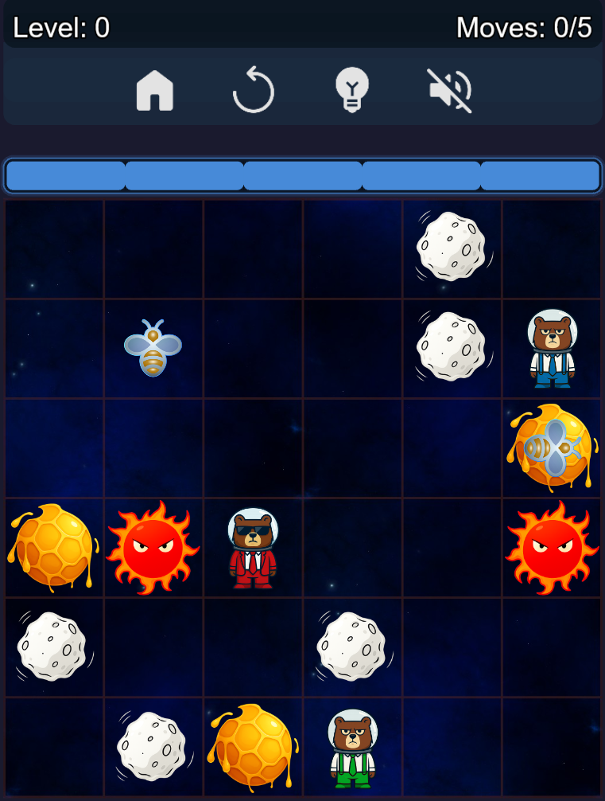

# Wappo Junior Remake (Guappo Junior)

A modern remake (fanmade) of the old **Wappo Junior** abandonware game (released on some Siemens phones in 2005).

*(Do not confuse this with Wappo or Wappo 2, which are remastered elsewhere. This one is different).*

🔗 **Play online:** [https://tazzit24.github.io/wappo-junior-remake/](https://tazzit24.github.io/wappo-junior-remake/)

*You can install it as a PWA in a supported browser.*

## How to play?

👉 [Read the game guide](https://tazzit24.github.io/wappo-junior-remake/docs/howtoplay.html)

## Why?

My old Siemens phone broke before I could finish Wappo Junior. Twenty years later, I decided to fix this:

* **200 original levels** decoded (from raw binary data to JSON).
* An **auto-solver** to check that every level is actually possible to win.
* My own art style: **space mafia bears** instead of the old characters.

## Installation & Development

Download this repo and start a local web server: serve `index.html` (Apache) or `server.js` (Node.js).

* **Stack:** JavaScript, Phaser 3, RexUI Plugin, HTML5/PWA.
* **Why Phaser?** It was a great tool to learn Canvas2D, even if it is a bit big for a 2005 mobile game.
* **AI and me:** 80% of the core logic comes from my old scripts. AI helped me clean the code, write small snippets, add the solver, and refactor the code for responsive design.

You can enter the Dev Mode by adding "?dev=true" in the URL bar. This allows to move the slider freely and to see every cell information.

## Contributing

This is mostly a personal hobby project, so there is no big roadmap. However, small contributions are welcome:
* **Art & Music**: Always open to better sprites, animations, or sounds.
* **Code**: Small bug fixes or useful tweaks are great, as long as they don't rewrite the whole project.

## Licensing

* **Source code:** Under the [MIT License](https://opensource.org/licenses/MIT). Free to use and change.
* **All art, audio, and assets:** Released under **CC0 (Public Domain)** — free for any use, without restriction. See [CREDITS.md](CREDITS.md) for third-party asset attributions.
* **Libraries (Phaser, RexUI):** Have their own rules and licenses.

## Fun Fact

Hidden in old files: a blueprint for a new character, **“Don.”** He was meant to move diagonally. Rules were never written.
